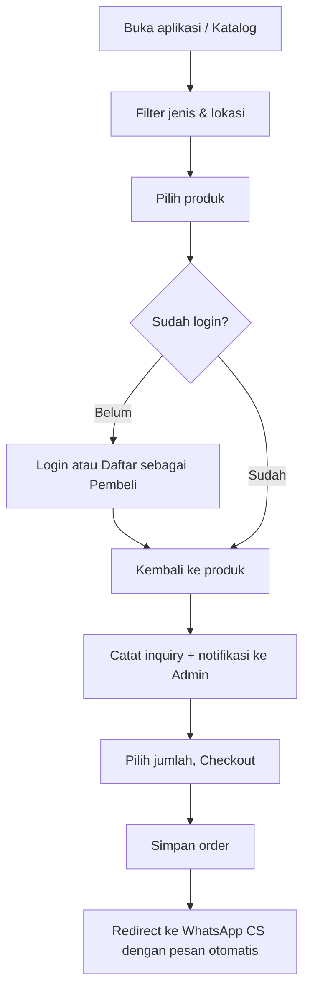
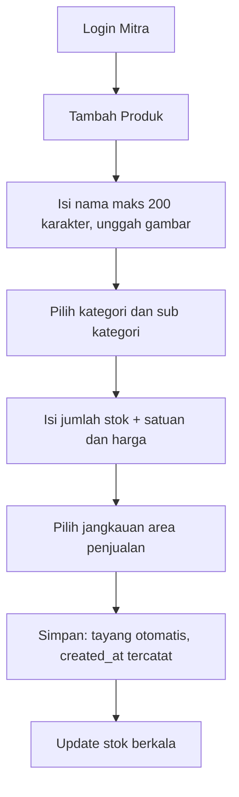
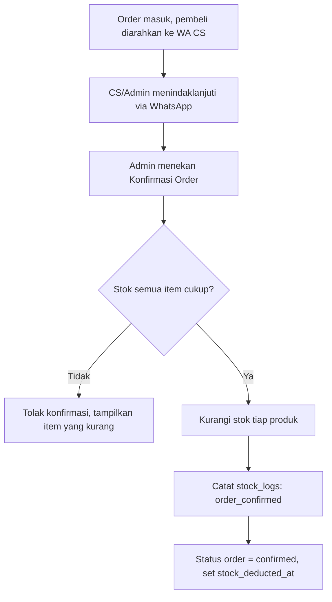

# Blueprint Aplikasi PWA Manajemen Stok Beras & Ternak

> Platform katalog dan manajemen stok produk pertanian/peternakan yang menghubungkan **Mitra Petani/Peternak**, **Admin/KMM (Karya Masyarakat Mandiri)**, dan **Pembeli/Donatur**.

---

## 1. Ringkasan Proyek

| Aspek | Keterangan |
|---|---|
| Jenis aplikasi | Progressive Web App (PWA), **mobile first** |
| Backend | Laravel (REST API + otentikasi berbasis token) |
| Produk | Beras, Sapi, Kambing, Domba |
| Pengguna | Mitra Petani/Peternak, Admin/KMM, Pembeli/Donatur |
| Model transaksi | Pembeli memilih produk → login/daftar → checkout → diarahkan ke WhatsApp CS (tanpa payment gateway pada fase 1) |
| Harga | Ditampilkan di katalog. Ada **dua harga**: *harga Mitra* (diinput Mitra) dan *harga jual* (ditetapkan Admin untuk pembeli). Pembeli hanya melihat harga jual |
| Stok | Berkurang **otomatis saat order dikonfirmasi** Admin |
| Login & daftar | Halaman login dengan pilihan **Mitra / Pembeli**; masuk dengan **email + password** atau **Google Auth**; pendaftaran mandiri sebagai Mitra atau Pembeli (lihat 7.5) |
| Branding | Nama **Panen Mandiri**, warna utama **hijau tua**, logo KMM |
| Filter utama | Jenis produk dan wilayah (kota/kabupaten di Indonesia) |

### Tujuan
1. Memberi Mitra alat sederhana untuk mengelola produk dan stok dari ponsel.
2. Memberi Admin/KMM visibilitas penuh atas seluruh produk Mitra dan kendali atas data master.
3. Memberi Pembeli/Donatur katalog yang mudah dijelajahi berdasarkan jangkauan wilayah.

---

## 2. Peran & Hak Akses

| Fitur | Pembeli/Donatur | Mitra | Admin/KMM |
|---|:---:|:---:|:---:|
| Lihat katalog & detail produk (tanpa login) | ✅ | ✅ | ✅ |
| Filter jenis produk & lokasi | ✅ | ✅ | ✅ |
| Daftar / login | ✅ | ✅ | ✅ |
| Checkout & diarahkan ke WhatsApp CS | ✅ | ❌ | ❌ |
| Riwayat pesanan sendiri | ✅ | ❌ | ✅ (semua) |
| Input/ubah/hapus produk milik sendiri | ❌ | ✅ | ✅ (semua) |
| Update stok & upload foto produk | ❌ | ✅ (milik sendiri) | ✅ (semua) |
| Atur jangkauan wilayah | ❌ | ✅ (milik sendiri) | ✅ (semua) |
| Input harga Mitra | ❌ | ✅ (milik sendiri) | ✅ (semua) |
| Tetapkan / ubah harga jual ke pembeli | ❌ | ❌ | ✅ |
| Lihat harga jual | ✅ | ✅ | ✅ |
| Lihat harga Mitra | ❌ | ✅ (milik sendiri) | ✅ |
| Konfirmasi order (memicu pengurangan stok) | ❌ | ❌ | ✅ |
| Rangkuman produk seluruh Mitra | ❌ | ❌ | ✅ |
| Manajemen user | ❌ | ❌ | ✅ |
| Manajemen kategori & sub kategori produk | ❌ | ❌ | ✅ |
| Pengaturan kontak CS (WhatsApp) | ❌ | ❌ | ✅ |
| Terima notifikasi minat pembeli | ❌ | opsional | ✅ |

**Implementasi:** gunakan paket `spatie/laravel-permission` (role: `pembeli`, `mitra`, `admin`) + Laravel Policy per model.

Catatan peran:
- **Pembeli dan Donatur adalah satu peran (`pembeli`)** dengan alur yang sama persis; tidak ada alur donasi terpisah.
- **Mitra dan Pembeli mendaftar sendiri** lewat halaman daftar (email + password atau Google). Satu email hanya untuk satu peran. Akun Admin dibuat oleh Admin lain atau seeder dan masuk lewat halaman login khusus (`/admin/masuk`).
- **Produk Mitra tayang tanpa persetujuan Admin** (Admin tetap dapat mengedit atau menyembunyikan produk kapan saja).

---

## 3. Arsitektur & Tech Stack

```
┌──────────────────────────┐       HTTPS / JSON       ┌──────────────────────────┐
│  PWA (Mobile First)      │ ───────────────────────► │  Laravel API             │
│  - Service Worker        │ ◄─────────────────────── │  - Sanctum Auth          │
│  - Web App Manifest      │                          │  - Policy / Role         │
│  - IndexedDB (cache)     │                          │  - Queue + Notification  │
└──────────────────────────┘                          └────────────┬─────────────┘
                                                                   │
                                          ┌────────────────────────┼───────────────────┐
                                          ▼                        ▼                   ▼
                                    MySQL/PostgreSQL        Storage (S3/Local)   Redis (queue/cache)
```

### Pilihan teknologi

| Lapisan | Rekomendasi |
|---|---|
| Backend | Laravel 11+, PHP 8.2+ |
| Auth | Email + password (Laravel Sanctum) dan Google OAuth 2.0 via **Laravel Socialite** |
| Role & permission | spatie/laravel-permission |
| Database | MySQL 8 / PostgreSQL |
| Frontend PWA | **Opsi A:** Vue 3 + Vite + Pinia + Tailwind (disarankan, `vite-plugin-pwa`) <br> **Opsi B:** Laravel Inertia + Vue/React + Tailwind |
| Manajemen gambar | Intervention Image (resize/kompresi) + Laravel Storage |
| Data wilayah | Paket `laravolt/indonesia` atau tabel sendiri dari data BPS/Kemendagri |
| Notifikasi | Database notification + Web Push (`laravel-notification-channels/webpush`) + email opsional |
| Email | Laravel Mail (SMTP/Mailgun/SES) lewat queue; SPF/DKIM dikonfigurasi agar email verifikasi tidak masuk spam |
| Antrian | Redis + Laravel Queue |
| Deploy | Nginx + PHP-FPM, HTTPS wajib (syarat PWA) |

---

## 4. Spesifikasi PWA

### 4.1 Web App Manifest (`manifest.webmanifest`)
```json
{
  "name": "Panen Mandiri",
  "short_name": "Panen Mandiri",
  "start_url": "/",
  "display": "standalone",
  "orientation": "portrait",
  "background_color": "#ffffff",
  "theme_color": "#1B5E20",
  "icons": [
    { "src": "/icons/icon-192.png", "sizes": "192x192", "type": "image/png" },
    { "src": "/icons/icon-512.png", "sizes": "512x512", "type": "image/png" },
    { "src": "/icons/icon-maskable.png", "sizes": "512x512", "type": "image/png", "purpose": "maskable" }
  ]
}
```
### 4.1a Branding
| Elemen | Ketentuan |
|---|---|
| Nama aplikasi | Panen Mandiri |
| Warna utama | **Hijau tua** — usulan `#1B5E20` (hover/aktif `#144718`, aksen terang `#E8F5E9`) |
| Logo | Logo KMM (PNG 512×512, latar transparan): lambang segitiga/gunung hijau-kuning-hitam dengan tulisan "MASYARAKAT MANDIRI". Simpan sebagai `/public/brand/logo-kmm.png` |
| Warna dari logo | Hijau muda `#ACCE22` / `#92B831`, kuning `#FFF000`, hitam `#1C1718`. Dipakai sebagai warna aksen (badge, highlight); warna utama tetap hijau tua |

Catatan penggunaan logo:
- Resolusi 512×512 sudah cukup untuk ikon PWA 512×512; ikon 192×192 dibuat dengan mengecilkan logo yang sama.
- Latar logo transparan, sehingga untuk ikon beri latar solid (putih atau hijau tua) agar tampil baik di layar utama ponsel.
- Untuk ikon **maskable**, beri ruang aman (*safe zone*) ±10% di semua sisi agar logo tidak terpotong oleh bentuk ikon Android.
- Tulisan "MASYARAKAT MANDIRI" menjadi sangat kecil pada ukuran ikon kecil (≤ 96 px); untuk ikon kecil dan favicon disarankan memakai **lambang segitiga saja** (logo tanpa tulisan).
- Simpan berkas logo di server sendiri (`/public/brand/` dan `/public/icons/`), jangan hotlink dari situs KMM. Bila ada, minta versi vektor (SVG) dari KMM untuk hasil paling tajam.

### 4.2 Service Worker — strategi cache
| Resource | Strategi |
|---|---|
| App shell (HTML/CSS/JS) | Precache |
| Ikon, font | Cache First |
| Katalog produk (GET API) | Stale-While-Revalidate |
| Gambar produk | Cache First dengan batas jumlah & umur |
| Aksi tulis (POST/PUT) | Network Only; untuk Mitra siapkan **antrian offline** (Background Sync) agar update stok tetap terkirim saat sinyal kembali |

### 4.3 Fitur PWA
- Bisa di-install ke layar utama (prompt "Tambahkan ke Layar Utama").
- Halaman fallback offline.
- Web Push notification (untuk Admin: minat pembeli baru).
- Skeleton loading & lazy-load gambar.

### 4.4 Prinsip UI Mobile First
- Desain mulai dari lebar 360px, lalu skala ke tablet/desktop.
- **Bottom navigation** (sesuai peran), area sentuh minimal 44×44px.
- Filter lewat *bottom sheet*, daftar produk berbentuk kartu 2 kolom.
- Form pendek bertahap (stepper) untuk input produk oleh Mitra.
- Target Lighthouse: Performance ≥ 85, PWA ✔.

---

## 5. Struktur Data Produk

Produk bersifat **tunggal, tanpa varian**: satu produk memiliki satu nama, satu kategori + sub kategori, satu stok, dan satu harga.

### 5.1 Form Input Produk (Mitra)

| Field | Input | Aturan |
|---|---|---|
| Nama Produk | Teks | Wajib, **maksimal 200 karakter** (tampilkan penghitung karakter) |
| Gambar | Unggah foto | Wajib minimal 1 foto (disarankan maks. 5); jpg/png/webp, maks. 2–5 MB per foto; dikompresi di sisi klien; foto pertama menjadi foto utama |
| Kategori Produk | Dropdown | Beras / Sapi / Domba / Kambing, dilanjutkan dropdown **Sub Kategori** yang menyesuaikan kategori (lihat 5.2) |
| Jumlah Stok | Angka + satuan | Beras: satuan dipilih Mitra (kg / kwintal / ton). Ternak: satuan tetap **ekor** |
| Harga | Angka (Rp) | **Harga Mitra** per satuan stok (per kg/kwintal/ton untuk beras, per ekor untuk ternak) |
| Jangkauan Area Penjualan | Multi-pilih kota/kabupaten | Wajib minimal 1; ada pencarian dan opsi "pilih semua di provinsi" |
| Waktu dibuat | Otomatis | `created_at` terisi otomatis saat produk disimpan; tidak diisi pengguna |

```
┌─────────────────────────────┐
│ ← Tambah Produk             │
│ Nama Produk       (0/200)   │
│ [_________________________] │
│ Gambar  [+] [img] [img]     │
│ Kategori      [ Sapi     ▾] │
│ Sub Kategori  [ Sedang   ▾] │
│ Jumlah Stok [__] [ ekor  ▾] │
│ Harga       Rp [_________]  │
│ Jangkauan Area Penjualan    │
│ [ Kab. Bogor ✕ ][ Kota Depok ✕ ] [+ Tambah] │
│ [        Simpan & Tayangkan ]│
└─────────────────────────────┘
```
Setelah disimpan, produk langsung tayang (tanpa persetujuan Admin) dan Admin menerima notifikasi produk baru.

### 5.2 Kategori & Sub Kategori Default

| Kategori | Sub kategori | Satuan stok |
|---|---|---|
| Beras | Pandan Wangi, IR64, Rojolele, IR 42, C4, Lainnya | kg / kwintal / ton |
| Sapi | Ringan (< 450 kg), Sedang (450–700 kg), Berat / Jumbo (> 700 kg) | ekor |
| Domba | Standar (18–22 kg), Medium (23–28 kg), Premium (29–35 kg), Jumbo (40–60 kg) | ekor |
| Kambing | Standar (18–22 kg), Medium (23–28 kg), Premium (29–35 kg), Jumbo (40–60 kg) | ekor |

- Data ini dimasukkan lewat *seeder* sebagai nilai awal; Admin dapat menambah, mengubah, atau menonaktifkan kategori dan sub kategori tanpa mengubah kode.
- Sub kategori hanya berfungsi sebagai pilihan klasifikasi (label); sistem tidak memvalidasi bobot aktual hewan.

---

## 6. Desain Database (ERD Ringkas)

```
users ──< partner_profiles
users ──< buyer_profiles (opsional)
users ──< products (mitra) ──< stock_logs
products ──< price_logs
products ──< product_photos
products ──< product_coverages >── regencies >── provinces
categories ──< subcategories
products >── categories, subcategories
orders ──< order_items
orders >── users (buyer)
inquiries (minat/klik produk) >── users, products
settings (kontak CS, dsb.)
notifications
```

### 6.1 Tabel utama

**users**
| Kolom | Tipe | Catatan |
|---|---|---|
| id | bigint PK | |
| name | string | |
| email | string, unique | Dari form daftar atau akun Google |
| email_verified_at | timestamp, nullable | Terisi setelah pengguna mengklik tautan verifikasi; otomatis terisi untuk akun Google dan akun yang dibuat Admin |
| phone | string, nullable | Wajib; disimpan dalam format `62xxxxxxxxxx`. Untuk akun Google diisi saat lengkapi profil. Dipakai untuk checkout dan tautan WhatsApp |
| password | string, nullable | Hash; kosong untuk akun yang hanya memakai Google |
| google_id | string, unique, nullable | ID akun Google (Socialite); kosong bila daftar dengan email |
| avatar | string, nullable | Foto profil Google |
| province_id / regency_id / district_id | FK nullable | Alamat: kota/kabupaten dan kecamatan (provinsi hanya untuk memudahkan pemilihan) |
| profile_completed_at | timestamp, nullable | Terisi setelah nama, HP, dan alamat lengkap |
| status | enum(`active`,`pending`,`suspended`) | `pending` = akun dibuat Admin dan belum login pertama; `suspended` = ditangguhkan Admin. Mitra/Pembeli yang daftar sendiri langsung `active` |
| timestamps | | |

**partner_profiles**
| Kolom | Tipe |
|---|---|
| id, user_id (FK) | |
| farm_name | string (nama usaha/kelompok tani) |
| address_detail | text, nullable | Detail alamat usaha (opsional); kecamatan dan kota/kabupaten ada di tabel `users` |
| description | text |

**categories** — `id`, `name` (Beras, Sapi, Domba, Kambing), `slug`, `type` (`rice` / `livestock`), `allowed_units` (beras: kg, kwintal, ton; ternak: ekor), `sort_order`, `is_active`

**subcategories**
| Kolom | Keterangan |
|---|---|
| id, category_id | |
| name | Mis. "Pandan Wangi" atau "Ringan" |
| label | Teks di dropdown, mis. "Ringan (< 450 kg)" |
| min_weight_kg, max_weight_kg | nullable; informasi rentang bobot ternak (mis. Sapi Ringan: min kosong, max 450; Sapi Berat / Jumbo: min 700, max kosong) |
| sort_order, is_active | |

**products** (tanpa varian)
| Kolom | Tipe | Catatan |
|---|---|---|
| id | bigint PK | |
| partner_id | FK users | Pemilik produk |
| category_id | FK categories | |
| subcategory_id | FK subcategories | |
| name | string(200) | Nama Produk, maksimal 200 karakter |
| partner_price | decimal(15,2) | **Harga Mitra** per satuan; diinput Mitra, tidak tampil ke pembeli |
| selling_price | decimal(15,2) | **Harga jual ke pembeli** per satuan; hanya Admin yang dapat mengubah. Otomatis disalin dari `partner_price` saat produk dibuat, sehingga produk langsung tayang |
| price_set_by / price_set_at | FK users / timestamp | Admin terakhir yang menetapkan harga jual |
| stock | decimal(12,2) | Jumlah stok |
| unit | enum(`kg`,`kwintal`,`ton`,`ekor`) | Beras: kg/kwintal/ton (dipilih Mitra); ternak: `ekor` |
| status | enum(`active`,`hidden`,`sold_out`) | `sold_out` otomatis saat stok 0 |
| created_at | timestamp | **Otomatis saat produk dibuat** |
| updated_at, deleted_at | timestamp | Soft delete |

**stock_logs** (riwayat perubahan stok)
`id, product_id, changed_by, order_id (nullable), old_stock, new_stock, reason, created_at`
`reason`: `mitra_update`, `admin_correction`, `order_confirmed`, `order_cancelled`

**price_logs** (riwayat harga)
`id, product_id, changed_by, old_partner_price, new_partner_price, old_selling_price, new_selling_price, created_at`

**product_photos** — `id, product_id, path, is_primary, sort_order`

**product_coverages** (jangkauan area penjualan) — `id, product_id, regency_id`; satu produk dapat memiliki banyak kota/kabupaten.

**provinces / regencies / districts** — data wilayah seluruh Indonesia: provinsi, kota/kabupaten (`id`, `province_id`, `name`, `type`), dan kecamatan (`id`, `regency_id`, `name`).

**orders** (checkout)
| Kolom | Keterangan |
|---|---|
| id, code (mis. `ORD-20261001-0001`) | |
| buyer_id | FK users |
| status | `pending`, `forwarded_to_cs`, `confirmed`, `completed`, `cancelled` |
| confirmed_by, confirmed_at | Admin yang mengonfirmasi; saat ini stok dikurangi |
| stock_deducted_at | timestamp nullable; penanda stok sudah dikurangi (mencegah pengurangan ganda) |
| total_estimate | |
| delivery_regency_id | |
| note | |
| whatsapp_url | link WA yang dibentuk saat checkout |

**order_items** — `id, order_id, product_id, qty, unit, selling_price_snapshot, partner_price_snapshot, title_snapshot`

**inquiries** — `id, buyer_id, product_id, created_at` (mencatat saat pembeli memilih produk, memicu notifikasi admin)

**settings** — `key`, `value` (mis. `cs_whatsapp_number`, `cs_greeting_template`)

### 6.2 Data Awal (Seeder) & Akun Uji Coba

Nama peran di sistem: **`admin`**, **`mitra`**, **`pembeli`**. Untuk uji coba aplikasi, seeder membuat tiga akun default berikut:

| Peran | Nama | Email | Password | Halaman login |
|---|---|---|---|---|
| `admin` | Admin | umbikidtv@gmail.com | admin123 | `/admin/masuk` |
| `mitra` | Mitra contoh | mitra@gmail.com | mitra123 | `/masuk` (tab Mitra) |
| `pembeli` | Pembeli contoh | pembeli@gmail.com | pembeli123 | `/masuk` (tab Pembeli) |

Ketentuan seeder:
- Ketiga akun dibuat dengan `email_verified_at` dan `profile_completed_at` sudah terisi, serta `status = active`, sehingga langsung dapat dipakai tanpa verifikasi email atau melengkapi profil (Mitra dapat langsung menambah produk, Pembeli langsung checkout).
- Nomor HP dan alamat (kota/kabupaten, kecamatan) diisi data contoh/dummy dari tabel wilayah.
- Seeder lain yang dijalankan bersama: `RoleSeeder` (admin, mitra, pembeli), `RegionSeeder` (provinsi, kota/kabupaten, kecamatan), dan `CategorySeeder` (kategori & sub kategori default, lihat 5.2).

```php
// database/seeders/TestAccountSeeder.php
public function run(): void
{
    // Hanya untuk lingkungan uji coba
    if (! app()->environment(['local', 'staging'])) {
        return;
    }

    $accounts = [
        ['name' => 'Admin',          'email' => 'umbikidtv@gmail.com', 'password' => 'admin123',   'role' => 'admin',   'phone' => '6281200000001'],
        ['name' => 'Mitra contoh',   'email' => 'mitra@gmail.com',     'password' => 'mitra123',   'role' => 'mitra',   'phone' => '6281200000002'],
        ['name' => 'Pembeli contoh', 'email' => 'pembeli@gmail.com',   'password' => 'pembeli123', 'role' => 'pembeli', 'phone' => '6281200000003'],
    ];

    foreach ($accounts as $a) {
        $user = User::updateOrCreate(['email' => $a['email']], [
            'name'                 => $a['name'],
            'password'             => Hash::make($a['password']),
            'phone'                => $a['phone'],
            'status'               => 'active',
            'email_verified_at'    => now(),
            'profile_completed_at' => now(),
            // province_id / regency_id / district_id: isi dengan wilayah contoh
        ]);
        $user->syncRoles($a['role']);
    }
}
```

> **Peringatan keamanan:** password di atas lemah dan hanya untuk uji coba. Seeder dibatasi ke lingkungan `local`/`staging` dan **tidak boleh dijalankan di produksi**. Sebelum rilis, hapus atau nonaktifkan akun uji coba, dan buat akun Admin produksi dengan password yang kuat (mis. lewat perintah artisan khusus). Jangan menyimpan password asli di repositori kode.

---

## 7. Fitur per Peran

### 7.1 Pembeli / Donatur (tampilan default aplikasi)
1. **Beranda/Katalog** — daftar semua produk aktif (beras, sapi, kambing, domba), tampil tanpa login.
2. **Filter**
   - Jenis produk: Semua / Beras / Sapi / Kambing / Domba.
   - Lokasi: pilih provinsi → kota/kabupaten; hasil hanya menampilkan produk yang **jangkauan wilayahnya mencakup** lokasi tersebut.
   - Opsional: sub kategori (jenis beras / kelas bobot), rentang harga, urutan (terbaru/termurah).
3. **Detail produk** — galeri foto, kategori & sub kategori, stok tersedia, **harga jual**, wilayah jangkauan, profil singkat mitra.
4. **Pilih produk** → jika belum login, diarahkan ke halaman **Login/Daftar** (tab Pembeli) lalu kembali ke produk yang dipilih.
5. **Keranjang/Checkout sederhana** — pilih jumlah, lokasi tujuan, catatan.
6. **Checkout selesai** → pesanan tersimpan → diarahkan ke **WhatsApp CS** dengan pesan otomatis berisi ringkasan pesanan.
7. **Riwayat pesanan** & profil.

### 7.2 Mitra Petani / Peternak
1. **Dashboard** — jumlah produk, total stok, produk stok menipis.
2. **Kelola produk (CRUD)** — memakai form input produk (lihat 5.1): Nama Produk (maks. 200 karakter), Gambar, Kategori + Sub Kategori (dropdown), Jumlah Stok, Harga, dan Jangkauan Area Penjualan (multi-pilih kota/kabupaten). Waktu pembuatan tercatat otomatis. Harga yang diisi adalah **harga Mitra**; tidak tampil ke pembeli, sedangkan harga jual ditetapkan Admin (lihat 7.4).
3. **Update stok cepat** — tombol +/−, atau input angka; satuan sesuai jenis (kg/kwintal/ton untuk beras; ekor untuk ternak). Setiap perubahan tercatat di `stock_logs`.
4. **Upload foto** — multi-foto, kompresi di sisi klien sebelum unggah, pilih foto utama.
5. **Atur jangkauan wilayah** — pilih satu atau lebih kota/kabupaten (multi-select dengan pencarian; opsi "pilih semua kota di provinsi").
6. **Profil usaha** — nama usaha, alamat, kontak.

### 7.3 Admin / KMM
1. **Dashboard rangkuman** — total produk per jenis, total stok, jumlah mitra aktif, pesanan/minat terbaru, grafik per wilayah.
2. **Rangkuman produk Mitra** — tabel dengan filter (mitra, jenis, wilayah, status); **edit produk** apa pun (data, stok, foto, status, wilayah) dan **menetapkan harga jual** (lihat 7.4).
3. **Manajemen user** — daftar, tambah, ubah, aktif/nonaktif, ganti peran, reset password.
4. **Manajemen kategori & sub kategori** — tambah/ubah/nonaktifkan kategori dan sub kategori produk (default: Beras, Sapi, Domba, Kambing beserta sub kategorinya, lihat 5.2).
5. **Pengaturan** — **nomor WhatsApp CS**, template pesan WA, nama aplikasi.
6. **Notifikasi** — pusat notifikasi minat/checkout pembeli serta produk baru dari Mitra (hanya pemberitahuan agar harga dapat ditinjau, bukan persetujuan), tandai sudah ditangani.
7. **Manajemen transaksi** — daftar transaksi berlangsung, ubah status, catatan internal, dan nomor HP Mitra/Pembeli yang langsung terhubung ke WhatsApp (lihat 7.6).

### 7.4 Pengelolaan Harga (Harga Mitra vs Harga Jual)

| | Harga Mitra | Harga Jual |
|---|---|---|
| Diinput oleh | Mitra (Admin dapat mengoreksi) | Admin |
| Dilihat oleh | Mitra pemilik & Admin | Semua pengguna (katalog) |
| Dipakai untuk | Acuan harga dari Mitra | Harga di katalog, checkout, dan pesan WhatsApp |

Aturan:
1. Saat Mitra menambah produk, ia mengisi Harga (`partner_price`); `selling_price` otomatis sama dengan harga tersebut sehingga produk **langsung tayang tanpa persetujuan Admin**.
2. Admin membuka manajemen produk dan mengisi/mengubah `selling_price` (per produk). Ada aksi massal "terapkan markup %" atau "samakan dengan harga Mitra" untuk mempercepat.
3. Admin dapat menyesuaikan `selling_price` kapan saja setelah produk tayang; perubahan langsung berlaku di katalog.
4. Bila Mitra mengubah harga Mitra, Admin mendapat notifikasi agar meninjau ulang harga jual (harga jual lama tetap berlaku sampai Admin mengubahnya).
5. Selisih (margin) = `selling_price − partner_price`, ditampilkan di dashboard Admin saja.
6. Setiap perubahan harga dicatat di `price_logs`; harga pada order disimpan sebagai *snapshot* agar tidak berubah untuk pesanan yang sudah dibuat.
7. API publik hanya mengembalikan `selling_price`; `partner_price` tidak boleh ikut ter-serialize di resource publik.

### 7.5 Login & Pendaftaran

**Halaman login (`/masuk`)**
```
┌─────────────────────────────┐
│        [Logo KMM]           │
│       Panen Mandiri         │
│                             │
│  ┌─────────┬─────────┐      │
│  │  Mitra  │ Pembeli │      │   ← pilihan peran (default: Pembeli)
│  └─────────┴─────────┘      │
│  Email    [______________]  │
│  Password [______________]👁 │
│  [        Masuk         ]   │
│  ────────── atau ────────── │
│  [ G  Masuk dengan Google ] │
│                             │
│  Belum punya akun? Daftar   │   ← tautan di bagian bawah
└─────────────────────────────┘
```
- Pilihan **Mitra / Pembeli** menentukan peran yang dipakai masuk. Jika akun terdaftar dengan peran lain, login ditolak dengan pesan jelas ("Akun ini terdaftar sebagai Pembeli").
- Klik **Daftar** membuka *bottom sheet*: **Daftar sebagai Mitra** atau **Daftar sebagai Pembeli**.
- Login Admin memakai halaman terpisah (`/admin/masuk`) yang tidak ditampilkan di aplikasi publik.
- Setelah login: Pembeli → katalog (atau kembali ke produk yang dipilih), Mitra → dashboard Mitra.

**Form daftar (email + password)**

| Field | Aturan |
|---|---|
| Nama | Wajib |
| Email | Wajib, unik |
| Nomor HP | Wajib; dinormalisasi ke format `62…` (dipakai untuk WhatsApp) |
| Alamat | Wajib: **Kota/Kabupaten** (pilih provinsi lebih dulu), lalu **Kecamatan** (daftar menyesuaikan kota/kabupaten) |
| Password dan konfirmasi | Wajib, minimal 8 karakter |

Form yang sama dipakai untuk Mitra dan Pembeli; yang membedakan hanya peran yang diberikan. Mitra dapat melengkapi nama usaha/kelompok tani setelah masuk.

**Verifikasi email (pendaftaran dengan email + password)**
1. Setelah form daftar dikirim, akun dibuat dengan `email_verified_at` kosong dan sistem mengirim email berisi tautan verifikasi (*signed URL*, berlaku 60 menit) melalui queue.
2. Pengguna diarahkan ke halaman **Cek Email Anda** (`/verifikasi-email`) yang menyediakan tombol **Kirim ulang tautan** (dibatasi, mis. 1× per menit) dan **Ganti email** bila salah ketik.
3. Setelah tautan diklik, `email_verified_at` terisi dan pengguna diarahkan kembali ke aplikasi (lalu ke **Lengkapi Profil** bila masih ada data yang kurang).
4. Sebelum email terverifikasi, pengguna masih dapat menjelajahi katalog, tetapi **tidak dapat checkout (Pembeli) atau menambah/mengubah produk (Mitra)**. Middleware `verified` mengalihkan ke `/verifikasi-email`.
5. Mengubah email di profil memicu verifikasi ulang untuk email baru.
6. Disarankan: akun email yang tidak diverifikasi dalam 7 hari dihapus otomatis (scheduled command).
7. Pengecualian: akun Google (email dari Google dianggap terverifikasi) dan akun Admin yang dibuat langsung oleh Admin lain/seeder.

Catatan implementasi: gunakan `MustVerifyEmail` bawaan Laravel dengan tautan yang diarahkan ke URL frontend PWA; email dikirim lewat queue agar pendaftaran tidak lambat.

**Daftar / login dengan Google**
1. Pengguna menekan **Daftar dengan Google** (atau **Masuk dengan Google**) pada tab peran yang dipilih.
2. Nama dan email diambil dari akun Google; akun dibuat dengan peran sesuai pilihan. Email dari Google otomatis dianggap **terverifikasi**, sehingga tidak perlu verifikasi email lagi.
3. Bila **Nomor HP atau Alamat (Kecamatan, Kota/Kabupaten) belum terisi**, pengguna otomatis diarahkan ke halaman **Lengkapi Profil** (`/lengkapi-profil`) dan **wajib** mengisinya.
4. Selama `profile_completed_at` kosong, pengguna belum dapat checkout (Pembeli) atau menambah produk (Mitra); middleware `EnsureProfileCompleted` mengalihkan ke halaman tersebut.
5. Jika email Google sudah terdaftar dengan peran yang sama (daftar via email), akun otomatis ditautkan ke Google (hanya untuk email Google yang terverifikasi).

### 7.6 Manajemen Transaksi (Dashboard Admin)

Menu **Transaksi** di dashboard Admin menampilkan transaksi yang sedang berlangsung beserta kontak semua pihak yang terlibat.

**Daftar transaksi**
- Filter: status (`pending`, `forwarded_to_cs`, `confirmed`, `completed`, `cancelled`), tanggal, wilayah, dan pencarian (kode order / nama).
- Setiap baris/kartu menampilkan: kode order, waktu, **Pembeli** (nama + nomor HP), daftar item (produk, sub kategori, jumlah, harga jual), **Mitra pemilik tiap item** (nama usaha + nomor HP), status, dan aksi (Konfirmasi, Batalkan, Selesai).
- Bila satu order berisi produk dari beberapa Mitra, item dikelompokkan per Mitra dan masing-masing punya nomor HP sendiri.

**Nomor HP langsung ke WhatsApp**
- Nomor HP Pembeli dan Mitra ditampilkan sebagai **tautan** yang langsung membuka chat WhatsApp: `https://wa.me/62xxxxxxxxxx?text=...`
- Pesan awal terisi otomatis dari template (diatur Admin di Pengaturan), misalnya:
  - Ke Pembeli: `Halo {nama}, kami dari KMM menindaklanjuti pesanan {kode_order}…`
  - Ke Mitra: `Halo {nama_usaha}, ada pesanan {kode_order} untuk {produk} × {qty}…`
- Nomor HP Mitra dan Pembeli **hanya tampil untuk Admin**; pembeli tidak melihat kontak Mitra.

```php
// App\Models\User
public function whatsappUrl(?string $message = null): string
{
    $n = preg_replace('/\D/', '', $this->phone);   // hanya angka
    $n = preg_replace('/^0/', '62', $n);            // 08xx → 628xx
    return "https://wa.me/{$n}" . ($message ? '?text=' . rawurlencode($message) : '');
}
```

**Detail transaksi:** ringkasan order, linimasa status, catatan internal, riwayat perubahan stok terkait (`stock_logs`), dan tombol **Konfirmasi Order** (memicu pengurangan stok, lihat 8.5).

---

## 8. Alur Utama

### 8.1 Alur Pembeli


### 8.2 Alur Mitra


### 8.3 Alur Notifikasi Admin
1. Pembeli memilih produk (dan/atau checkout) → event `ProductInquired` / `OrderCreated`.
2. Listener memasukkan job ke queue.
3. Admin menerima notifikasi **in-app** (database) + **Web Push**.
4. Admin menindaklanjuti lewat WhatsApp CS dan mengubah status pesanan.

### 8.4 Format Link WhatsApp
```
https://wa.me/{NOMOR_CS}?text={urlencode(pesan)}
```
Contoh template pesan:
```
Halo CS, saya ingin memesan:
Kode Pesanan: ORD-20261001-0001
- Sapi Sedang (450–700 kg) × 2 ekor (Mitra: Kelompok Tani Makmur)
Lokasi tujuan: Kab. Bogor
Nama: {nama pembeli} | HP: {no hp}
```

### 8.5 Pengurangan Stok Otomatis saat Order Dikonfirmasi



Aturan implementasi:
- Dijalankan dalam **satu transaksi database** dengan `lockForUpdate()` pada baris `products` agar tidak terjadi *race condition* antar order.
- Konversi satuan ke satuan dasar sebelum mengurangi (beras: 1 kwintal = 100 kg, 1 ton = 1.000 kg; ternak: ekor).
- Pengurangan hanya terjadi **sekali** (dijaga oleh `stock_deducted_at`).
- Jika order yang sudah `confirmed` dibatalkan, stok **dikembalikan otomatis** dan dicatat sebagai `order_cancelled`.
- Jika stok menjadi 0, status produk otomatis `sold_out`, dan Mitra menerima notifikasi stok habis.
- Pembeli yang baru checkout (belum dikonfirmasi) **tidak** mengurangi stok.

```php
DB::transaction(function () use ($order, $admin) {
    foreach ($order->items as $item) {
        $product = Product::lockForUpdate()->find($item->product_id);
        $qty = UnitConverter::toBase($item->qty, $item->unit, $product->unit);
        abort_if($product->stock < $qty, 422, "Stok {$item->title_snapshot} tidak cukup");
        $product->decrement('stock', $qty);
        StockLog::create([/* order_id, old/new stock, reason: order_confirmed */]);
    }
    $order->update(['status' => 'confirmed', 'confirmed_by' => $admin->id,
                    'confirmed_at' => now(), 'stock_deducted_at' => now()]);
});
```

---

## 9. Rancangan API (Laravel)

Prefix: `/api/v1`

### Publik
| Method | Endpoint | Fungsi |
|---|---|---|
| GET | `/products` | Katalog + filter `?category=sapi&subcategory_id=..&regency_id=3201&q=...&page=` |
| GET | `/products/{id}` | Detail produk |
| GET | `/regions/provinces` | Daftar provinsi |
| GET | `/regions/regencies?province_id=` | Daftar kota/kabupaten |
| GET | `/regions/districts?regency_id=` | Daftar kecamatan |
| GET | `/categories` | Kategori beserta sub kategori (untuk dropdown dan filter) |
| GET | `/settings/public` | Kontak CS, nama aplikasi |

### Auth
| Method | Endpoint |
|---|---|
| POST | `/auth/register/mitra` (daftar Mitra: nama, email, HP, kecamatan, kota/kab, password) |
| POST | `/auth/register/pembeli` (daftar Pembeli, field sama) |
| POST | `/auth/login` (`email`, `password`, `role` = mitra atau pembeli) |
| GET | `/auth/email/verify/{id}/{hash}` (tautan bertanda tangan dari email) |
| POST | `/auth/email/resend` (kirim ulang tautan verifikasi; dibatasi) |
| GET | `/auth/google/redirect?role=mitra` atau `?role=pembeli` |
| GET | `/auth/google/callback` |
| PUT | `/auth/profile` (lengkapi HP dan alamat; wajib untuk akun Google) |
| POST | `/auth/logout` |
| GET | `/auth/me` |

### Pembeli (`role:pembeli`)
| Method | Endpoint | Fungsi |
|---|---|---|
| POST | `/inquiries` | Catat minat produk → notifikasi admin |
| POST | `/orders` | Checkout, mengembalikan `whatsapp_url` |
| GET | `/orders` / `/orders/{id}` | Riwayat pesanan |

### Mitra (`role:mitra`)
| Method | Endpoint | Fungsi |
|---|---|---|
| GET/POST | `/mitra/products` | List / buat produk |
| GET/PUT/DELETE | `/mitra/products/{id}` | Detail / ubah / hapus |
| PATCH | `/mitra/products/{id}/stock` | Update stok |
| POST | `/mitra/products/{id}/photos` | Upload foto |
| DELETE | `/mitra/photos/{id}` | Hapus foto |
| PUT | `/mitra/products/{id}/coverages` | Set jangkauan wilayah (array `regency_ids`) |
| GET | `/mitra/dashboard` | Ringkasan |

### Admin (`role:admin`)
| Method | Endpoint | Fungsi |
|---|---|---|
| GET | `/admin/summary` | Rangkuman dashboard |
| GET | `/admin/products` | Seluruh produk Mitra + filter |
| PUT | `/admin/products/{id}` | Edit produk apa pun |
| PATCH | `/admin/products/{id}/stock` | Koreksi stok |
| PATCH | `/admin/products/{id}/price` | Tetapkan/ubah harga jual (`selling_price`) |
| POST | `/admin/products/bulk-price` | Penetapan harga jual massal (markup %) |
| CRUD | `/admin/users` | Manajemen user |
| CRUD | `/admin/categories`, `/admin/subcategories` | Kategori & sub kategori |
| GET/PUT | `/admin/settings` | Kontak CS, template WA |
| GET | `/admin/notifications` | Notifikasi |
| GET | `/admin/orders` | Daftar transaksi + filter; setiap baris menyertakan `whatsapp_url` Pembeli dan Mitra |
| PATCH | `/admin/orders/{id}` | Ubah status / catatan internal |
| POST | `/admin/orders/{id}/confirm` | Konfirmasi order + kurangi stok otomatis |
| POST | `/admin/orders/{id}/cancel` | Batalkan order (stok dikembalikan bila sudah dikonfirmasi) |

### Logika filter wilayah (contoh Eloquent)
```php
Product::query()
    ->active()
    ->when($request->category, fn ($q, $c) => $q->whereHas('category', fn ($q) => $q->where('slug', $c)))
    ->when($request->subcategory_id, fn ($q, $id) => $q->where('subcategory_id', $id))
    ->when($request->regency_id, fn ($q, $id) =>
        $q->whereHas('coverages', fn ($q) => $q->where('regency_id', $id)))
    ->with(['category', 'subcategory', 'primaryPhoto'])
    ->paginate(12);
```

---

## 10. Struktur Halaman (Sitemap)

```
/                         → Katalog (default, sama dengan tampilan pembeli)
/produk/:id               → Detail produk
/masuk                    → Login (pilihan Mitra / Pembeli, email atau Google)
/daftar                   → Pilih daftar sebagai Mitra atau Pembeli
/daftar/mitra  /daftar/pembeli → Form pendaftaran
/lengkapi-profil          → Lengkapi HP & alamat (akun Google)
/verifikasi-email         → Info verifikasi & kirim ulang tautan
/admin/masuk              → Login Admin (terpisah)
/checkout                 → Checkout pembeli
/pesanan                  → Riwayat pesanan (pembeli)
/akun                     → Profil

/mitra                    → Dashboard Mitra
/mitra/produk             → Daftar produk
/mitra/produk/baru        → Input produk (stepper)
/mitra/produk/:id/edit    → Ubah produk, stok, foto, wilayah
/mitra/profil             → Profil usaha

/admin                    → Dashboard
/admin/produk             → Rangkuman & edit produk
/admin/pengguna           → Manajemen user
/admin/kategori           → Kategori & sub kategori
/admin/pesanan            → Pesanan
/admin/notifikasi         → Notifikasi
/admin/pengaturan         → Kontak CS, template WA
```

### Navigasi bawah (bottom nav)
| Peran | Menu |
|---|---|
| Pembeli | Beranda · Filter · Pesanan · Akun |
| Mitra | Dashboard · Produk · Tambah · Akun |
| Admin | Dashboard · Produk · Pengguna · Notifikasi · Pengaturan |

---

## 11. Keamanan & Validasi

- HTTPS wajib; header keamanan (CSP, HSTS).
- **Semua input pengguna wajib aman dari SQL injection** (aturan lengkap di 11.1).
- Sanctum token, rate limiting pada login/daftar (`throttle`).
- Otorisasi per baris: Mitra hanya dapat mengakses produk miliknya (Policy).
- Validasi input: ukuran & tipe gambar (jpg/png/webp, maks 2–5 MB), stok ≥ 0, satuan sesuai jenis produk.
- Konversi satuan beras (kg ↔ kwintal ↔ ton) di backend: 1 kwintal = 100 kg, 1 ton = 1.000 kg.
- Password disimpan sebagai hash (bcrypt/argon2), minimal 8 karakter; akun Google tidak menyimpan password. Rate limiting dan penguncian sementara setelah beberapa kali gagal login.
- Satu email hanya untuk satu peran; login pada tab yang tidak sesuai peran ditolak.
- Pendaftaran mandiri Mitra tidak memerlukan persetujuan Admin; Admin dapat menangguhkan akun atau menyembunyikan produk bila ada penyalahgunaan. Verifikasi email wajib pada pendaftaran mandiri; tambahkan reCAPTCHA/Turnstile pada form daftar untuk mencegah akun palsu.
- Nomor HP Mitra/Pembeli hanya dapat dilihat Admin (dan pemilik akun).
- Pastikan `partner_price` tidak bocor lewat API publik (gunakan API Resource terpisah untuk publik dan Mitra/Admin).
- Audit log perubahan produk/stok oleh Admin.
- Proteksi data pribadi pembeli sesuai UU PDP.

### 11.1 Pencegahan SQL Injection (Wajib untuk Semua Input)

Prinsip utama: **input pengguna tidak pernah digabungkan langsung ke dalam teks SQL**. Semua nilai dikirim sebagai *parameter binding* (prepared statement) dan semua input divalidasi lebih dulu.

#### A. Aturan wajib
1. **Gunakan Eloquent / Query Builder** untuk seluruh akses data; keduanya memakai parameter binding PDO secara otomatis.
2. **Dilarang** menyambung (*concatenate*) atau menyisipkan variabel input ke string SQL. Raw query (`DB::select`, `whereRaw`, `selectRaw`, `orderByRaw`, `havingRaw`) hanya boleh dengan tanda `?`/named binding, dan wajib melalui code review. `DB::unprepared` dilarang.
3. **Nama kolom, tabel, dan arah urutan tidak dapat di-bind**, sehingga wajib memakai *whitelist* (mis. parameter `sort` hanya boleh `created_at` atau `selling_price`; `direction` hanya `asc`/`desc`).
4. **Pencarian (`LIKE`)**: nilai tetap di-bind, karakter `%` dan `_` pada input di-escape, dan panjang kata kunci dibatasi (mis. maks. 100 karakter).
5. **Selalu validasi dengan FormRequest** dan gunakan `$request->validated()`. Jangan memakai `$request->all()` untuk `create`/`update`; definisikan `$fillable` secara eksplisit di setiap model.
6. **ID dan nilai pilihan** (kategori, sub kategori, kota/kabupaten, kecamatan, status) divalidasi `integer` + `exists:` atau `Rule::in([...])`, bukan dipercaya begitu saja.
7. **Jangan menampilkan pesan error SQL ke pengguna**: `APP_DEBUG=false` di produksi, halaman error generik, detail error hanya di log internal.
8. **Hak akses database minimal**: akun database aplikasi hanya memiliki `SELECT`, `INSERT`, `UPDATE`, `DELETE` pada skema aplikasi (tanpa `DROP`, `ALTER`, `CREATE`, `GRANT`, `FILE`). Migrasi dijalankan memakai akun terpisah saat deploy.
9. **Nama file unggahan** dibuat sistem (hash/UUID), nama asli dari pengguna tidak dipakai untuk query maupun path.
10. Perbarui Laravel dan dependensi secara berkala (`composer audit`) agar celah yang diketahui tidak terbawa.

#### B. Contoh implementasi

```php
// ❌ DILARANG: input digabung langsung ke SQL
DB::select("SELECT * FROM products WHERE name LIKE '%$q%'");
Product::whereRaw("category_id = $id")->get();

// ✅ Aman: Query Builder/Eloquent (binding otomatis) + whitelist identifier
$sort      = in_array($request->sort, ['created_at', 'selling_price'], true) ? $request->sort : 'created_at';
$direction = $request->direction === 'asc' ? 'asc' : 'desc';

Product::query()
    ->where('status', 'active')
    ->when($request->q, fn ($q, $kw) =>
        $q->where('name', 'like', '%' . addcslashes($kw, '%_') . '%'))
    ->orderBy($sort, $direction)
    ->paginate(12);

// ✅ Bila terpaksa memakai raw, wajib dengan binding
Product::whereRaw('stock > ?', [$minStock])->get();
DB::select('select * from orders where buyer_id = ?', [$userId]);
```

```php
// app/Http/Requests/StoreProductRequest.php
public function rules(): array
{
    $category = Category::find($this->category_id);   // hasil berupa model, bukan SQL mentah

    return [
        'name'           => ['required', 'string', 'max:200'],
        'category_id'    => ['required', 'integer', 'exists:categories,id'],
        'subcategory_id' => ['required', 'integer',
                             Rule::exists('subcategories', 'id')->where('category_id', $this->category_id)],
        'stock'          => ['required', 'numeric', 'min:0', 'max:99999999'],
        'unit'           => ['required', Rule::in($category?->allowed_units ?? [])],
        'price'          => ['required', 'numeric', 'min:0', 'max:999999999999'],
        'regency_ids'    => ['required', 'array', 'min:1', 'max:600'],
        'regency_ids.*'  => ['integer', 'distinct', 'exists:regencies,id'],
        'photos'         => ['required', 'array', 'min:1', 'max:5'],
        'photos.*'       => ['image', 'mimes:jpg,jpeg,png,webp', 'max:5120'],
    ];
}
```

#### C. Pengamanan per input

| Input | Pengamanan |
|---|---|
| Nama Produk (maks. 200 karakter) | Validasi `string` + batas panjang; disimpan lewat Eloquent (binding); output di-escape saat ditampilkan |
| Kategori, sub kategori | `integer` + `exists`; sub kategori harus milik kategori yang dipilih |
| Jumlah stok, harga | `numeric`, batas minimum dan maksimum; kolom bertipe `decimal` |
| Satuan | Whitelist (`Rule::in`) sesuai `allowed_units` kategori |
| Jangkauan area (kota/kabupaten) | Array `integer`, `exists:regencies,id`, `distinct`, jumlah dibatasi |
| Gambar | Validasi jenis dan ukuran; nama file dibuat sistem |
| Pencarian katalog (`q`) | Binding + escape `LIKE`; panjang dibatasi |
| Filter dan urutan (`sort`, `direction`, `status`, tanggal) | Whitelist / `Rule::in` / validasi `date` |
| ID di URL (produk, order, user) | Route model binding atau validasi `integer`, ditambah Policy otorisasi |
| Email, nama, nomor HP | Validasi `email`, `string` + panjang, HP hanya digit (dinormalisasi ke `62…`) |
| Alamat (provinsi, kota/kab, kecamatan) | `integer` + `exists`; kecamatan harus milik kota/kabupaten yang dipilih |
| Password | Hanya diproses lewat `Hash::make` / `Hash::check`, tidak pernah masuk ke SQL mentah |
| Catatan order / catatan internal | `string` dengan batas panjang; disimpan lewat Eloquent; di-escape saat ditampilkan |
| Template pesan WhatsApp | `string` dengan batas panjang; saat membentuk tautan gunakan `rawurlencode` |

#### D. Pengujian
- **Feature test (Pest/PHPUnit)** untuk setiap endpoint yang menerima input, memakai payload seperti `' OR '1'='1`, `1; DROP TABLE products;--`, dan `%' UNION SELECT ...`. Hasil yang benar: respons 422 atau data kosong, tanpa error SQL, dan tanpa perubahan data.
- **Analisis statis** (Larastan/PHPStan) dan pencarian rutin untuk `DB::raw`, `whereRaw`, `selectRaw`, `orderByRaw`, `DB::unprepared`; setiap kemunculan wajib direview.
- **Uji keamanan di staging** sebelum rilis dengan OWASP ZAP atau sqlmap.
- Pantau log error database dan lonjakan respons 422/500 sebagai tanda percobaan serangan.

#### E. Lapisan pendukung
Rate limiting, WAF (opsional), dan escape output (jangan memakai `{!! !!}` / `v-html` untuk input pengguna) melindungi dari serangan lain seperti XSS dan *brute force*, tetapi **bukan pengganti** parameter binding dan validasi di atas.

---

## 12. Kebutuhan Non-Fungsional

| Aspek | Target |
|---|---|
| Performa | LCP < 2,5 dtk pada jaringan 3G/4G |
| Ketersediaan | 99% uptime |
| Kompatibilitas | Chrome/Edge/Firefox/Safari (Android & iOS terbaru) |
| Skalabilitas | Pagination, indeks DB pada `regency_id`, `product_type_id`, `status` |
| Backup | Harian untuk DB & storage foto |
| Bahasa | Indonesia (siap multi-bahasa) |

> Catatan iOS: Web Push pada iOS hanya berfungsi bila PWA sudah di-install ke layar utama.

---

## 13. Rencana Pengembangan (Roadmap)

| Fase | Cakupan | Estimasi |
|---|---|---|
| **0. Persiapan** | Konfirmasi kebutuhan, branding, UI/UX wireframe mobile, setup repo & CI | 1–2 minggu |
| **1. Fondasi** | Setup Laravel, auth + verifikasi email, role & permission, data wilayah, seeder kategori & sub kategori + akun uji coba | 2 minggu |
| **2. Modul Mitra** | CRUD produk (kategori/sub kategori), stok, foto, jangkauan wilayah | 3 minggu |
| **3. Katalog Pembeli** | Katalog, filter jenis & lokasi, detail produk, PWA shell | 2–3 minggu |
| **4. Checkout & Notifikasi** | Login/daftar pembeli, inquiry, order, redirect WhatsApp, notifikasi admin | 2 minggu |
| **5. Modul Admin** | Dashboard, edit produk, manajemen user & kategori, pengaturan CS | 2–3 minggu |
| **6. PWA & Optimasi** | Service worker, offline, Web Push, performa | 1–2 minggu |
| **7. QA & Rilis** | UAT dengan Mitra & KMM, uji keamanan (termasuk SQL injection), perbaikan, deploy produksi | 2 minggu |

---

## 14. Pengembangan Lanjutan (Backlog)

- Payment gateway / pencatatan donasi & bukti transfer.
- Chat langsung pembeli–mitra.
- Ulasan & rating mitra.
- Laporan stok & penjualan (ekspor Excel/PDF).
- Integrasi ongkos kirim dan estimasi pengiriman antarwilayah.
- Kuitansi/invoice otomatis.

---

## 15. Asumsi & Pertanyaan Terbuka

Asumsi yang dipakai dalam blueprint ini:
1. Transaksi pembayaran **di luar aplikasi** (diselesaikan via CS WhatsApp).
2. Mitra dan Pembeli mendaftar sendiri; produk Mitra **tayang tanpa persetujuan Admin**. Akun Admin dibuat oleh Admin/seeder.
3. Produk **tanpa varian**: satu produk memiliki satu kategori + sub kategori, satu stok, dan satu harga. Satuan beras dipilih Mitra (kg/kwintal/ton), satuan ternak adalah ekor. Form produk hanya berisi field pada 5.1 (tanpa deskripsi dan minimal pemesanan); foto 1–5 buah.
4. Jangkauan area penjualan ditentukan per produk (multi-pilih kota/kabupaten saat input produk).
5. Harga jual awal = harga Mitra, dan dapat diubah per produk oleh Admin kapan saja.
6. Konfirmasi order dilakukan manual oleh Admin (setelah koordinasi via WhatsApp); stok baru dikurangi pada saat itu.

Hal yang perlu dikonfirmasi dengan KMM:
- [x] Harga ditampilkan di katalog: harga jual ditetapkan Admin, terpisah dari harga Mitra (lihat 7.4).
- [x] Produk Mitra tayang tanpa persetujuan Admin.
- [x] Pembeli dan Donatur memakai alur yang sama (satu peran `pembeli`).
- [x] Satu nomor CS (`cs_whatsapp_number` di pengaturan Admin).
- [x] Stok berkurang otomatis saat order dikonfirmasi (lihat 8.5).
- [x] Branding: Panen Mandiri, hijau tua, logo KMM (berkas PNG 512×512 sudah diterima).
- [x] Metode login: email + password atau Google Auth, dengan pilihan peran Mitra / Pembeli di halaman login.
- [x] Verifikasi email wajib pada pendaftaran mandiri (lihat 7.5).
- [x] Pendaftaran mandiri untuk Mitra dan Pembeli; akun Google wajib melengkapi HP dan alamat (kecamatan, kota/kabupaten).
- [x] Produk tanpa varian; kategori dan sub kategori default sudah ditetapkan (lihat 5.2).
- [ ] Rentang bobot sub kategori Domba dan Kambing memiliki celah (mis. Standar 18–22 kg dan Medium 23–28 kg). Rentang Sapi sudah berkesinambungan. Saat ini sub kategori hanya label pilihan Mitra tanpa validasi bobot; konfirmasi apakah perlu aturan khusus.
